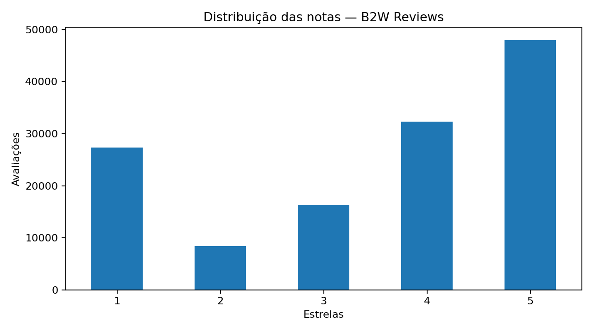

# Análise de Sentimentos e Tópicos em Avaliações de E-commerce

Projeto acadêmico de **Processamento de Linguagem Natural (NLP)** utilizando avaliações reais do conjunto **B2W-Reviews01** (Americanas).

## Objetivo
Classificar avaliações em sentimentos negativo, neutro e positivo; avaliar criticamente os erros e identificar assuntos recorrentes que possam orientar investigações de negócio.

## Dados
O conjunto contém **132.373 avaliações**. A coluna `overall_rating` foi convertida em três classes: 1–2 estrelas (negativo), 3 (neutro) e 4–5 (positivo). A variável `recommend_to_a_friend` foi utilizada na auditoria dos rótulos.

## Metodologia
1. **Auditoria:** valores ausentes, duplicatas, distribuição das notas e consistência dos rótulos.
2. **Representação textual:** TF-IDF com unigramas e bigramas; divisão estratificada em treino e teste.
3. **Classificação:** Regressão Logística e Linear SVM; avaliação por acurácia, macro-F1, recall e matriz de confusão.
4. **Análise de erros:** identificação de avaliações ambíguas e linguagem mista.
5. **Tópicos:** NMF para explorar temas recorrentes e cruzar temas com sentimentos.

## Principais aprendizados
Em uma análise anterior do projeto, a Regressão Logística apresentou **aproximadamente 84,6% de acurácia**, mas apenas **23,6% de recall na classe neutra**. A auditoria também identificou que **aproximadamente 88,5% das avaliações de três estrelas recomendavam o produto**, indicando ambiguidade na definição operacional de neutralidade. **Reexecute o notebook para reproduzir e validar esses resultados antes de divulgá-los como resultados finais.**

## Como executar
1. Baixe o dataset original `B2W-Reviews01.csv` da fonte B2W/Americanas e coloque-o na pasta do projeto.
2. Instale as dependências: `pip install -r requirements.txt`.
3. Abra `projeto_nlp_americanas.ipynb` no Jupyter ou VS Code e execute as células na ordem.
4. Revise os nomes interpretativos dos tópicos NMF a partir dos termos efetivamente encontrados. Os nomes provisórios no notebook não são resultados finais.

**Observação:** o dataset não é incluído no repositório para evitar redistribuição desnecessária. Os gráficos de modelos e tópicos são gerados durante a execução; não são apresentados como resultados executados neste pacote.

## Tecnologias
Python · Pandas · scikit-learn · TF-IDF · Regressão Logística · Linear SVM · NMF · Matplotlib

## Contexto
Projeto acadêmico — Ciência de Dados e Inteligência Artificial, PUC-SP.
